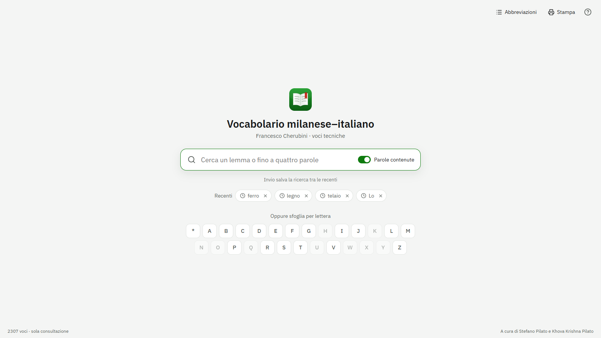
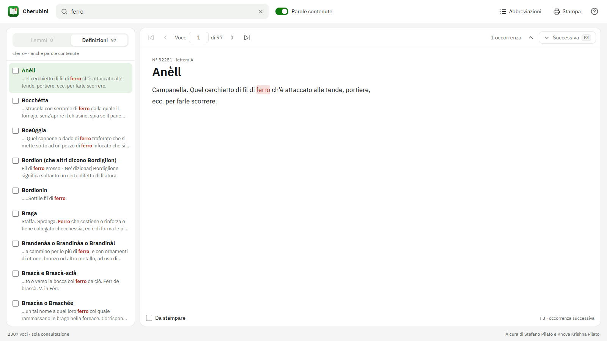

# Vocabolario Cherubini — edizione digitale


Le **voci tecniche** del *Vocabolario milanese–italiano* di Francesco Cherubini (1839–1856): 2.307 lemmi di mestieri, strumenti e materiali, da cercare anche dentro le definizioni.

Il progetto riprende *Voci tecniche*, il programma in Microsoft Access 2000 realizzato da Stefano Pilato, e ne porta tutte le funzioni in due edizioni moderne:

- **Web**: si usa dal browser, senza installare niente → <https://krishnapilato.github.io/cherubini-digital-edition/>
- **Desktop**: app portatile per Windows, macOS e Linux, con Java già incluso → [ultima versione](https://github.com/krishnapilato/cherubini-digital-edition/releases/latest)

## Come si presenta





<!--  -->

## Cosa si può fare

- **Cercare mentre si scrive**, fino a quattro parole insieme: si trovano le voci che le contengono tutte.
- **Parole esatte o contenute**: con *Parole contenute* `ferro` trova anche «ferroso». Accenti e maiuscole non contano.
- **Lemmi e definizioni** in due elenchi separati, con le parole cercate evidenziate.
- **Occorrenze**: `F3` porta alla parola successiva e, finita la voce, alla voce seguente.
- **Sfogliare per lettera**, oppure tutti i lemmi con `*`.
- **Spostarsi tra le voci** con i pulsanti, con le frecce o scrivendo la posizione.
- **Ricerche recenti**, ciascuna eliminabile con la X.
- **Stampare** una selezione di voci.
- **Guida all'uso** animata, dal pulsante `?`.
- **Abbreviazioni**: il pannello c'è già, l'elenco arriverà in una prossima versione.

## Struttura del repository

| Cartella | Contenuto |
|---|---|
| `data/` | `cherubini.json`, l'unica fonte dei dati, condivisa dalle due edizioni |
| `guide/` | La guida all'uso (HTML, CSS, JS con GSAP), condivisa dalle due edizioni |
| `desktop/` | App JavaFX: Java 27, JavaFX 27, AtlantaFX, SQLite |
| `web/` | App React: React 19.3, TypeScript 7, Vite 8, Zustand, GSAP |
| `tests/` | Casi di ricerca condivisi dai test delle due edizioni |
| `docs/screenshots/` | Le immagini di questo README |
| `.github/workflows/` | Pubblicazione del sito e delle versioni desktop |

## Edizione desktop

Serve un JDK 27 con Maven.

```bash
cd desktop
mvn javafx:run
```

`mvn package` crea `target/cherubini.jar`, un unico jar con dentro JavaFX per Windows, macOS e Linux. Durante la build Maven genera il database SQLite partendo da `data/cherubini.json` (`desktop/tools/BuildDatabase.java`), quindi il file `.db` non sta nel repository. Anche la guida viene presa da `guide/`: il pulsante `?` la estrae in una cartella temporanea e la apre nel browser.

Il codice viene controllato a ogni compilazione: i warning di `javac` (`-Xlint:all`) sono errori e PMD, con le regole di `desktop/pmd-ruleset.xml`, ferma la build se trova import, campi, variabili o metodi inutilizzati, codice troppo complesso o errori tipici. Vale per `mvn compile`, `mvn javafx:run`, la configurazione di IntelliJ e le build delle release. `mvn test` esegue i test JUnit (vedi [Test e controlli](#test-e-controlli)).

## Edizione web

Serve Node.js 24 o successivo.

```bash
cd web
npm i --force
npm run dev
```

L'app si apre su <http://localhost:5173/cherubini-digital-edition/> e la guida su `/guida/`, servita direttamente da `guide/`. Il `--force` serve perché typescript-eslint non dichiara ancora il supporto a TypeScript 7.

| Comando | Cosa fa |
|---|---|
| `npm run typecheck` | Controllo dei tipi con TypeScript 7 in modalità rigorosa |
| `npm run lint` | ESLint con le regole SonarJS (le stesse di SonarLint) e jsx-a11y; ogni avviso blocca |
| `npm test` | Test con Vitest |
| `npm run build` | Controllo dei tipi, lint e build di produzione in `web/dist` |

Alcune scelte tecniche:

- I dati non stanno nel JavaScript. Il JSON viene scaricato in parallelo all'app (con un `preload`) e salvato nel `sessionStorage`.
- Anche lo stato della consultazione è nel `sessionStorage`, tramite Zustand: ricerca, lettera, voce aperta, voci da stampare e ricerche recenti. Ricaricando la pagina si resta dove si era; chiudendo la scheda il browser cancella tutto. Nessun dato esce dal browser.
- L'elenco dei risultati è virtualizzato con TanStack Virtual: anche con 2.307 voci la pagina contiene solo le righe visibili.
- I pannelli e la guida sono `<dialog>` nativi: focus, tasto Esc e ritorno del focus li gestisce il browser.

Punteggi [Lighthouse](https://developer.chrome.com/docs/lighthouse) 13.5 del sito pubblicato (ottobre 2026):

| | Prestazioni | Accessibilità | Best practice | SEO |
|---|:-:|:-:|:-:|:-:|
| Desktop | 100 | 100 | 100 | 100 |
| Mobile | 95 | 100 | 100 | 100 |

## Test e controlli

La ricerca è scritta due volte, in TypeScript e in Java, quindi le due edizioni passano gli stessi casi: [`tests/search-cases.json`](tests/search-cases.json) contiene normalizzazione di accenti e maiuscole, divisione della ricerca in parole, parti da evidenziare, conteggio delle voci per lettera e i risultati attesi di varie ricerche sul vocabolario vero. Li leggono sia Vitest (`web/src/search.test.ts`) sia JUnit (`desktop/src/test/java`); ci sono poi test sulle ricerche recenti e sulla selezione da stampare.

- **CI** (`.github/workflows/ci.yml`): a ogni push e pull request esegue tipi, lint, test e build del web e, su Linux e Windows, compilazione senza warning, PMD e test del desktop.
- **Pubblicazione**: il sito viene pubblicato e le release desktop vengono create solo se gli stessi controlli passano.
- **Dipendenze**: Dependabot (`.github/dependabot.yml`) propone ogni settimana gli aggiornamenti di npm, Maven e GitHub Actions, che passano dalla CI prima di poter essere uniti.

## Pubblicazione

- **Sito**: ogni push su `main` che tocca `web/`, `guide/`, `tests/` o `data/cherubini.json` ricostruisce il sito e lo pubblica su GitHub Pages.
- **Desktop**: un tag `v*` (per esempio `v1.0.2`) costruisce i pacchetti portatili e crea la release su GitHub:
  - `Cherubini-windows.zip` per Windows 10/11
  - `Cherubini-macos-apple-silicon.zip` per Mac con chip Apple
  - `Cherubini-macos-intel.zip` per Mac con processore Intel
  - `Cherubini-linux-x86_64.AppImage` per Linux

  I pacchetti non sono firmati; le note di ogni release spiegano come superare l'avviso al primo avvio.

## Autori

- **Francesco Cherubini** (1789–1851), autore del *Vocabolario milanese–italiano*.
- **Stefano Pilato**, autore del programma *Voci tecniche* da cui provengono la selezione e la trascrizione delle voci.
- **Khova Krishna Pilato**, autore delle edizioni desktop e web.

## Licenza

Il software è proprietario: vedi [LICENSE](LICENSE). Il file elenca anche le licenze dei componenti di terze parti usati (font, librerie).
