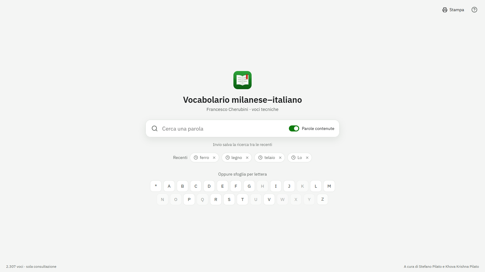
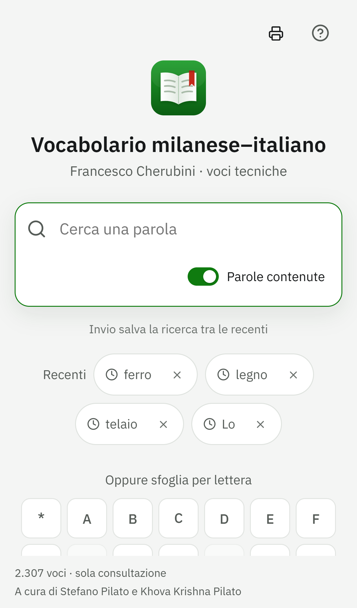
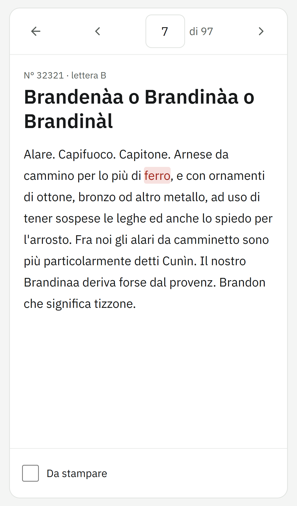
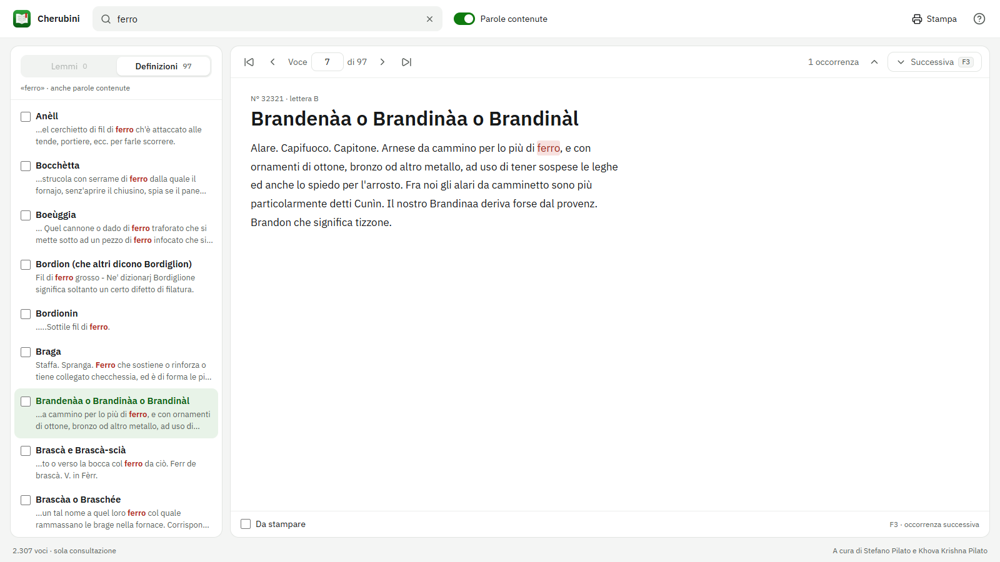

# Vocabolario Cherubini — digital edition

[](https://github.com/krishnapilato/cherubini-digital-edition/actions/workflows/deploy-web.yml)
[](https://github.com/krishnapilato/cherubini-digital-edition/releases/latest)


The **technical entries** of the *Vocabolario milanese–italiano* by Francesco Cherubini (1839–1856): 2,307 headwords about trades, tools and materials, searchable inside their definitions too.

The project picks up *Voci tecniche*, the Microsoft Access 2000 program made by Stefano Pilato, and brings it to two modern editions. The interface of both is in Italian.

- **Web**: runs in the browser, with nothing to install → <https://krishnapilato.github.io/cherubini-digital-edition/>
- **Desktop**: portable app for Windows 11, with Java included → [latest version](https://github.com/krishnapilato/cherubini-digital-edition/releases/latest). On a Mac or Linux use the web edition.

## Screenshots

<table>
  <tr>
    <td align="center">
      
      
    </td>
  </tr>
  <tr>
    <td align="center">
      
      
    </td>
  </tr>
</table>

<!--  -->

## What it does

- **Search as you type**, up to four words at once: it finds the entries that contain all of them, from the first letters on.
- **Contained or exact words**: *Parole contenute* is on at the start, so `ferro` also finds «ferroso». Turned off, it looks for the exact word, and if nothing is found a button turns it back on. Accents and capitals don't matter.
- **Headwords and definitions** in two separate lists, with the searched words highlighted.
- **Occurrences**: `F3` goes to the next match and, at the end of an entry, on to the following entry.
- **Browse by letter**, or all headwords with `*`.
- **Move between entries** with the buttons, the arrow keys or by typing a position.
- **Recent searches**, each one removable with its X.
- **Print** a selection of entries.
- **Animated user guide**, from the `?` button.

## Repository layout

| Folder | Contents |
|---|---|
| `data/` | `cherubini.json`, the single source of the data, shared by both editions |
| `guide/` | The user guide (HTML, CSS, JS with GSAP), shared by both editions |
| `desktop/` | JavaFX app: Java 27, JavaFX 27, AtlantaFX, SQLite |
| `web/` | React app: React 19.3, TypeScript 7, Vite 8, Zustand, GSAP |
| `tests/` | Search cases shared by the tests of both editions |
| `docs/decisions/` | [Why the project is built the way it is](docs/decisions/README.md) |
| `docs/screenshots/` | The images in this README |
| `.github/workflows/` | CI, and publishing of the site and the desktop versions |

## Desktop edition

Requires JDK 27. Maven doesn't need to be installed: the wrapper (`mvnw`, `mvnw.cmd` on Windows) downloads the version fixed in `.mvn/wrapper/maven-wrapper.properties`, Maven 3.10.0, the same one CI and releases use.

```bash
cd desktop
./mvnw javafx:run
```

`./mvnw package` creates `target/cherubini.jar`, a single jar with JavaFX and SQLite for Windows only: the desktop edition is for Windows ([decision 0002](docs/decisions/0002-portable-unsigned-desktop-packages.md)). During the build, Maven generates the SQLite database from `data/cherubini.json` (`desktop/tools/BuildDatabase.java`), so the `.db` file is not in the repository. The guide also comes from `guide/`: the `?` button extracts it to a temporary folder and opens it in the browser.

The code is checked on every build: `javac` warnings (`-Xlint:all`) are errors, and PMD, with the rules in `desktop/pmd-ruleset.xml`, stops the build on unused imports, fields, variables or methods, overly complex code and common mistakes, in the app and in its tests. PMD runs once the tests are compiled, so it applies to `./mvnw test`, `./mvnw verify`, the IntelliJ run configuration and release builds, but not to `./mvnw compile` or `./mvnw javafx:run`. `./mvnw test` runs the JUnit tests (see [Tests and checks](#tests-and-checks)).

## Web edition

Requires Node.js 26 or later; CI and the site build use the newest Node.js 26.

```bash
cd web
npm i
npm run dev
```

The app opens at <http://localhost:5173/cherubini-digital-edition/> and the guide at `/guida/`, served directly from `guide/`. The `overrides` in `package.json` are there because typescript-eslint doesn't declare support for TypeScript 7 yet, nor eslint-plugin-jsx-a11y for ESLint 10.

| Command | What it does |
|---|---|
| `npm run typecheck` | Type check with TypeScript 7 in strict mode |
| `npm run lint` | ESLint with the SonarJS rules (the same as SonarLint) and jsx-a11y; any warning fails |
| `npm run format` | Formats the code with Prettier (`npm run format:check` only checks it) |
| `npm test` | Tests with Vitest |
| `npm run e2e` | Interface tests with Playwright on the production build (requires Chrome) |
| `npm run build` | Type check, lint, format check and production build in `web/dist` |

Some technical choices:

- The data isn't in the JavaScript. The JSON is downloaded alongside the app (with a `preload`) and kept in `sessionStorage`.
- The browsing state is in `sessionStorage` too, through Zustand: search, letter, open entry and entries to print. Reloading the page keeps your place; closing the tab makes the browser erase it. Recent searches are in `localStorage`, so they are still there at the next visit, as on the desktop (see [decision 0017](docs/decisions/0017-recent-searches-persist-on-the-web.md)). No data leaves the browser.
- The results list is virtualized with TanStack Virtual: even with 2,307 entries the page only holds the visible rows.
- The browser's Back button goes from the entry to the list (on phones) and from the list to the home page. On phones the entry fills the screen and you can also swipe sideways to change it.
- The panels and the guide are native `<dialog>` elements: the browser handles focus, the Esc key and returning focus.
- A Content Security Policy lets the browser load only the site's own files, and the referrer policy keeps the page address private when following a link elsewhere (see [decision 0015](docs/decisions/0015-content-security-policy.md)).

[Lighthouse](https://developer.chrome.com/docs/lighthouse) 13.5 scores of the published site (October 2026):

| | Performance | Accessibility | Best practices | SEO |
|---|:-:|:-:|:-:|:-:|
| Desktop | 100 | 100 | 100 | 100 |
| Mobile | 95 | 100 | 100 | 100 |

## Tests and checks

The search is written twice, in TypeScript and in Java, so both editions must pass the same cases: [`tests/search-cases.json`](tests/search-cases.json) holds the folding of accents and capitals, the splitting of a search into words, the parts to highlight, the number of entries per letter and the expected results of various searches on the real vocabulary. Both Vitest (`web/src/search.test.ts`) and JUnit (`desktop/src/test/java`) read them; there are also tests for recent searches and the print selection.

The interface tests use the real app as a person would: they search by typing, browse a letter, use `F3`, save and remove a recent search, and open and close panels and the guide.

- **Web**: Playwright (`web/e2e/`, `npm run e2e`) opens the production build in Chrome and also fails if the page writes an error or a warning to the console.
- **Desktop**: JUnit with the JavaFX robot (`InterfaceTest`) clicks and presses keys on the app's window; it runs on the JavaFX headless platform, so no screen is needed.

Automation:

- **CI** (`.github/workflows/ci.yml`): on every push and pull request it runs types, lint, tests, build and interface tests for the web and, on Windows, the warning-free compile, PMD, tests and interface tests for the desktop.
- **Publishing**: the site is published and desktop releases are created only if the same checks pass.
- **Dependencies**: Dependabot (`.github/dependabot.yml`) proposes npm, Maven and GitHub Actions updates every week, and they go through CI before they can be merged.

## Publishing

- **Site**: every push to `main` that touches `web/`, `guide/`, `tests/` or `data/cherubini.json` rebuilds the site and publishes it on GitHub Pages.
- **Desktop**: a `v*` tag (for example `v1.0.0`) builds the portable Windows package, `Vocabolario-Cherubini-<version>.zip`, and creates the GitHub release.

  The package isn't signed; the release notes explain how to get past the warning on first launch. Before being published, the package is started with `--smoke-test`: the app opens its window on the JavaFX headless platform, checks that it shows the vocabulary and exits, and if anything is wrong the release stops. Each release also publishes `SHA256SUMS.txt` with the SHA-256 fingerprint of the package, to verify that the downloaded file is intact.

## Authors

- **Francesco Cherubini** (1789–1851), author of the *Vocabolario milanese–italiano*.
- **Stefano Pilato**, author of the *Voci tecniche* program, the source of the selection and transcription of the entries.
- **Khova Krishna Pilato**, author of the desktop and web editions.

## License

The software is proprietary: see [LICENSE](LICENSE). The file also lists the licenses of the third-party components used (fonts, libraries).
